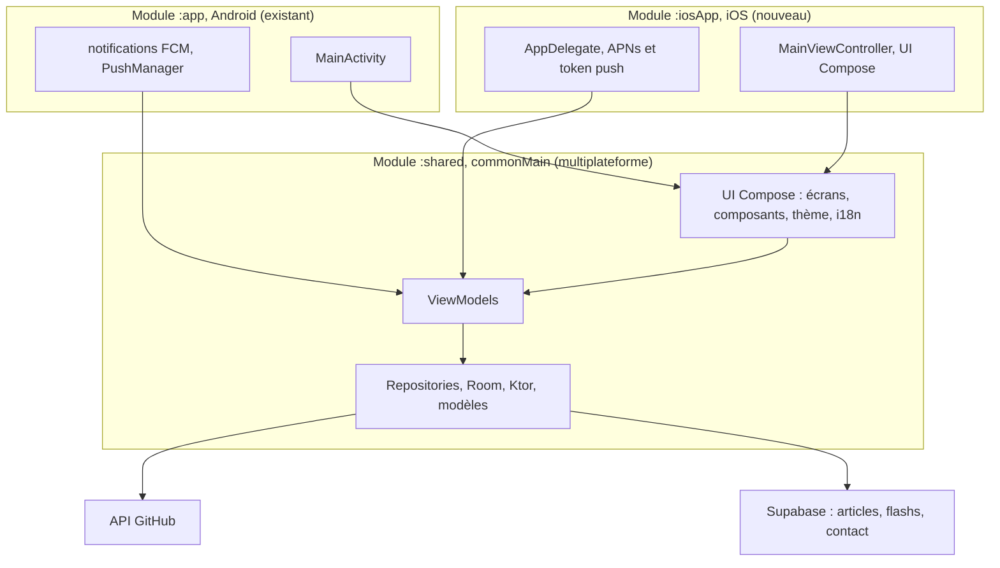
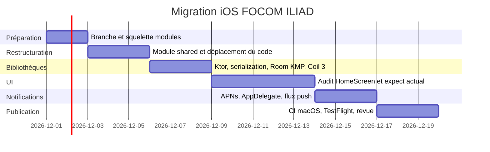

# Plan de migration iOS : FOCOM ILIAD

**De l'app Android native vers une application iPhone / iPad avec Kotlin Multiplatform**

Projet source : `Android_FOCOM` (app Android « FOCOM UES ILIAD », version 1.0.7, versionCode 8, applicationId `com.fo.uesiliad`). Objectif : publier la même application sur l'App Store, sans posséder de Mac, en réutilisant le code Kotlin existant.

---

## 1. Principe

Un APK ne se convertit pas en app iOS : il faut recompiler le code source pour iOS. La bonne stratégie ici est **Kotlin Multiplatform (KMP)** avec **Compose Multiplatform** :

- la logique métier et l'interface (déjà 100 % Jetpack Compose) sont déplacées dans un module partagé `commonMain` ;
- l'app Android existante continue de fonctionner à l'identique ;
- une nouvelle app iOS (`iosApp`) affiche la même interface Compose ;
- la compilation et la signature iOS se font sur un **runner macOS de GitHub Actions**, jamais sur votre PC.

L'app étant entièrement en Compose avec une architecture MVVM propre, c'est le scénario idéal : la majorité du code se déplace sans réécriture.

## 2. État des lieux du code

Environ 11 200 lignes de Kotlin réparties en 28 fichiers.

| Zone | Fichiers | Lignes | Verdict iOS |
|---|---|---|---|
| `ui/screens` (HomeScreen, RepoExplorerScreen, SplashScreen) | 3 | 6 274 | À déplacer, avec audit des APIs Android |
| `ui/components` (MarkdownContent, PrivacyPolicyDialog, NotificationSettingsSheet) | 3 | 948 | Déplacement direct |
| `ui/i18n` (AppLocalization, ContentLocalization) | 2 | 1 107 | Déplacement direct |
| `ui/theme` + `ui/viewmodel` (GitResumeViewModel) | 4 | ~660 | Déplacement direct |
| `data/model` (FocomModels, GitHubModels, ContactMessage, SavedRepo) | 4 | ~200 | Annotations à migrer de Moshi vers kotlinx.serialization |
| `data/remote` (GitHubService, SupabaseService) | 2 | 137 | Retrofit à remplacer par Ktor |
| `data/local` (RepoDatabase, ArticleCache, FlashBannerCache, FocomContentCache) | 4 | ~250 | Room : support iOS officiel, faible changement |
| `data/repository` (FocomDataRepository, GitHubRepository, SimulatorLogic) | 3 | 1 029 | Déplacement quasi direct |
| `notifications` (FocomMessagingService, FocomNotificationHelper, FocomPushManager) | 3 | 376 | Android uniquement : équivalent Swift à écrire |
| `MainActivity.kt` | 1 | 263 | Reste Android ; équivalent iOS = ComposeViewController |
| Tests (JUnit, Robolectric, Roborazzi) | 13 | ~1 100 | Restent Android ; la logique commune devient testable partout |

**Dépendances actuelles** : Retrofit + OkHttp + Moshi (codegen KSP), Room (KSP), Firebase Messaging, Coil, Navigation Compose, Lifecycle, secrets Gradle plugin (fichier `.env`), Robolectric / Roborazzi, Google Services. Gradle 9.3.1, compileSdk 36, minSdk 24.

## 3. Architecture cible



Une seule base de code Compose, deux points d'entrée natifs (Android et iOS), les données distantes inchangées.

## 4. Versions cibles (à confirmer au moment du démarrage)

Dernières versions stables observées en octobre 2026 :

| Outil / bibliothèque | Version indicative |
|---|---|
| Kotlin | 2.4.20 |
| Compose Multiplatform | 1.12.x |
| Room (multiplateforme) | 3.0.x |
| Ktor client | 3.6.x |
| kotlinx.serialization | dernière stable |
| Coil 3 | dernière stable |
| Gradle | 9.3.1 (déjà en place) |
| Xcode (runner CI) | 26 ou plus (exigé par Apple depuis avril 2026) |

Vérifiez les versions à jour sur [klibs.io](https://klibs.io) et avec l'assistant [kmp.jetbrains.com](https://kmp.jetbrains.com).

## 5. Phase 0 : préparation (1 jour)

1. Créer une branche `kmp` dans le dépôt.
2. Ajouter les plugins dans `build.gradle.kts` racine : `org.jetbrains.kotlin.multiplatform`, `org.jetbrains.kotlin.plugin.compose`, `org.jetbrains.kotlin.plugin.serialization`.
3. Ajouter le module `shared` dans `settings.gradle.kts` :

```kotlin
rootProject.name = "FOCOM ILIAD"
include(":app")
include(":shared")
include(":iosApp")
```

4. S'assurer que l'app Android compile toujours après chaque étape : c'est le filet de sécurité permanent de la migration.

## 6. Phase 1 : restructuration en module partagé (2 à 3 jours)

Squelette de `shared/build.gradle.kts` :

```kotlin
plugins {
    alias(libs.plugins.kotlin.multiplatform)
    alias(libs.plugins.kotlin.compose)
    alias(libs.plugins.kotlin.serialization)
    alias(libs.plugins.google.devtools.ksp)
    alias(libs.plugins.android.library)
}

kotlin {
    androidTarget()
    iosArm64()
    iosSimulatorArm64()

    applyDefaultHierarchyTemplate()

    sourceSets {
        commonMain.dependencies {
            implementation(compose.runtime)
            implementation(compose.material3)
            implementation(compose.components.resources)
            implementation(libs.ktor.client.core)
            implementation(libs.ktor.client.content.negotiation)
            implementation(libs.kotlinx.serialization.json)
            implementation(libs.room.runtime)
            implementation(libs.coil3.compose)
            implementation(libs.navigation.compose)      // build multiplateforme
            implementation(libs.lifecycle.viewmodel.compose)
            implementation(libs.kotlinx.coroutines.core)
        }
    }
    // Room KSP : configurer ksp pour les cibles iosArm64 / iosSimulatorArm64
}
```

Déplacements progressifs, dans cet ordre :

1. `data/model` (après migration des annotations, phase 2) ;
2. `ui/theme`, `ui/i18n`, `ui/viewmodel` : déplacement direct ;
3. `data/repository` ;
4. `ui/components` puis `ui/screens` ;
5. Les ressources `res/drawable` et `res/mipmap` utilisées par l'UI migrent vers les ressources Compose Multiplatform (`compose.components.resources`) : `drawable/focom_logo…`, photos des délégués (`delegate_*.webp`).

Le module `:app` garde `MainActivity`, `AndroidManifest.xml`, le pipeline de signature et les tests Robolectric / Roborazzi.

## 7. Phase 2 : remplacement des bibliothèques Android (2 à 3 jours)

### 7.1 Moshi vers kotlinx.serialization

Remplacement mécanique dans les 4 fichiers de `data/model` et les modèles inline de `SupabaseService` :

```kotlin
// Avant (Moshi)
@Json(name = "image_url") val imageUrl: String? = null

// Après (kotlinx.serialization)
@SerialName("image_url") val imageUrl: String? = null
```

Ajouter `@Serializable` sur chaque classe de modèle, supprimer `ksp(libs.moshi.kotlin.codegen)`, ajouter le plugin `kotlin.serialization`. Les modèles sont petits : une demi-journée suffit.

### 7.2 Retrofit + OkHttp vers Ktor

Les deux interfaces font 137 lignes au total. Exemple pour `GitHubService` :

```kotlin
class GitHubApi(httpClient: HttpClient) {
    suspend fun getRootContents(
        owner: String,
        repo: String,
        token: String? = null
    ): List<GitHubContent> = httpClient.get("repos/$owner/$repo/contents") {
        header("User-Agent", "GitResume-App")
        token?.let { header("Authorization", it) }
    }.body()

    suspend fun getRawText(url: String, token: String? = null): String =
        httpClient.get(url) {
            header("User-Agent", "GitResume-App")
            token?.let { header("Authorization", it) }
        }.body()
}
```

Le client Ktor commun :

```kotlin
val client = HttpClient {
    install(ContentNegotiation) {
        json(Json { ignoreUnknownKeys = true })
    }
}
```

Fichiers concernés : `GitHubService.kt` (67 lignes), `SupabaseService.kt` (70 lignes), plus l'initialisation dans les repositories. Les en-têtes Supabase (`apikey`, `Authorization`, `Prefer`) et les paramètres PostgREST (`select`, `is_published`, `order`, `limit`) se transposent tels quels en paramètres Ktor. Supprimer `logging.interceptor` (OkHttp) et utiliser le `Logging` de Ktor côté Android si besoin.

### 7.3 Room vers Room KMP

Room supporte officiellement iOS. `RepoDatabase`, `ArticleCache`, `FlashBannerCache` et `FocomContentCache` se déplacent presque tels quels dans `commonMain`. Changements :

- le builder `Room.databaseBuilder(context, …)` devient une fonction `expect` en commun, `actual` sur chaque plateforme (sur iOS : `Room.databaseBuilder(name = "focom.db")` sans contexte) ;
- configurer KSP pour les cibles iOS ;
- le schéma de base est conservé : les caches des utilisateurs Android ne changent pas.

### 7.4 Coil vers Coil 3

Coil 3 est multiplateforme : remplacer `implementation(libs.coil.compose)` par `coil3.coil-compose` et migrer `AsyncImage` vers la version Coil 3 (`coil3.network` pour le chargement réseau). Les usages sont simples (logo, photos de délégués, images d'articles).

### 7.5 Ce qui reste côté Android uniquement

`google-services.json`, le plugin Secrets (fichier `.env`), `BuildConfig`, `Robolectric`, `Roborazzi`. Le plugin Secrets et `BuildConfig` sont des concepts Android : les valeurs de `.env` (URL Supabase, clé API) deviennent des propriétés de build passées à `shared` via `buildConfigField` par cible, ou une simple classe de configuration par plateforme via `expect` / `actual`.

## 8. Phase 3 : audit des APIs Android dans l'UI (3 à 5 jours)

C'est le plus gros chantier, dominé par `HomeScreen.kt` (4 526 lignes). Toute API Android dans le code partagé doit être isolée derrière une déclaration `expect` en commun et une implémentation `actual` par plateforme :

```kotlin
// commonMain
expect fun openExternalUrl(url: String)

// androidMain
actual fun openExternalUrl(url: String) {
    context.startActivity(Intent(Intent.ACTION_VIEW, Uri.parse(url)))
}

// iosMain
actual fun openExternalUrl(url: String) {
    UIApplication.sharedApplication.openURL(NSURL(string = url))
}
```

Points à repérer dans `HomeScreen.kt`, `RepoExplorerScreen.kt`, `SplashScreen.kt`, `MarkdownContent.kt`, `PrivacyPolicyDialog.kt` :

| API Android probable | Traitement iOS |
|---|---|
| Ouvrir un lien externe (navigateur) | `expect/actual` ou bibliothèque web browser |
| Partage d'article (`Intent.ACTION_SEND`) | feuille de partage iOS (`UIActivityViewController`) |
| Presse-papiers | API clipboard multiplateforme |
| `Toast` / `Snackbar` | remplacer par Snackbar Compose commun |
| Permissions notifications (`POST_NOTIFICATIONS`) | demande de permission iOS dans `iosApp` |
| Accès réseau état (`ACCESS_NETWORK_STATE`) | API connectivité par plateforme |
| `LocalContext.current` | à éliminer du code commun (source classique d'erreurs de compilation iOS) |

Méthode conseillée : déplacer `HomeScreen.kt` dans `commonMain`, lancer la compilation des cibles iOS, et corriger chaque erreur signalée. Le compilateur est le meilleur auditeur ici.

## 9. Phase 4 : notifications push sur iOS (2 à 3 jours)

Aujourd'hui : FCM via `FocomMessagingService` (service FirebaseMessagingService), `FocomPushManager` (112 lignes) et `FocomNotificationHelper` (173 lignes), token FCM envoyé à votre backend (Supabase). Le ruban de réglages `NotificationSettingsSheet` (451 lignes) est de l'UI Compose : il se déplace en commun.

Sur iOS, le SDK Firebase Apple gère tout, côté Swift :

```swift
// iosApp / AppDelegate.swift
import UIKit
import FirebaseCore
import FirebaseMessaging

class AppDelegate: NSObject, UIApplicationDelegate {
  func application(_ application: UIApplication,
                   didFinishLaunchingWithOptions launchOptions: [UIApplication.LaunchOptionsKey: Any]? = nil) -> Bool {
    FirebaseApp.configure()
    Messaging.messaging().delegate = self
    application.registerForRemoteNotifications()
    return true
  }

  func application(_ application: UIApplication,
                   didRegisterForRemoteNotificationsWithDeviceToken deviceToken: Data) {
    Messaging.messaging().apnsToken = deviceToken
  }
}

extension AppDelegate: MessagingDelegate {
  func messaging(_ messaging: Messaging, didReceiveRegistrationToken fcmToken: String?) {
    // Envoyer le token à Supabase, comme FocomPushManager le fait sur Android
  }
}
```

À faire :

1. Créer l'app Firebase iOS (bundle id `com.fo.uesiliad.ios` ou similaire) et récupérer `GoogleService-Info.plist`.
2. Générer une clé APNs `.p8` depuis le compte Apple Developer et la charger dans la console Firebase (Paramètres, Cloud Messaging).
3. Après cela, **votre backend Supabase existant envoie vers les deux plateformes sans changement** : FCM route vers APNs automatiquement pour les tokens iOS.
4. Gérer la permission de notification iOS (`UNUserNotificationCenter.requestAuthorization`), l'apparence des notifications iOS (title / body), et le compteur de badge éventuel.

## 10. Phase 5 : publication sans Mac (2 jours)

Vous avez déjà `.github/workflows/android-release.yml`. Ajouter `ios-release.yml` :

```yaml
name: iOS Release
on:
  workflow_dispatch:

jobs:
  build:
    runs-on: macos-15          # Xcode 26 disponible
    steps:
      - uses: actions/checkout@v4
      - uses: actions/setup-java@v4
        with: { distribution: temurin, java-version: 21 }
      - name: Build iOS app
        run: ./gradlew :shared:linkReleaseFrameworkIosArm64
      - name: Archive and sign (xcodebuild)
        run: xcodebuild -project iosApp/iosApp.xcodeproj -scheme iosApp -configuration Release -archivePath build/App.xcarchive archive
        env:
          # Certificat et profil chargés depuis les secrets GitHub
      - name: Export IPA
        run: xcodebuild -exportArchive -exportPath build/ipa ...
      - name: Upload to TestFlight
        run: xcrun altool --upload-app -f build/ipa/App.ipa ...
```

Prérequis et coûts :

| Élément | Détail |
|---|---|
| Compte Apple Developer | 99 $ / an, indispensable pour publier. Les builds TestFlight de test exigent ce compte |
| App Store Connect API key | à créer une fois, stockée dans les secrets GitHub (`App Store Connect`, `Integrations`) |
| Runner macOS GitHub Actions | facturé 10x en minutes sur dépôt privé. Avec 2 000 min/mois du plan gratuit : environ 200 min macOS, soit 10 à 15 builds par mois : suffisant |
| Xcode 26 | exigé par Apple pour toute soumission depuis avril 2026 |
| Test sur iPhone | via TestFlight sur votre iPhone (le simulateur iOS nécessite un Mac) |
| Fichiers Xcode | le squelette `iosApp` (projet Xcode, Info.plist, AppDelegate) se copie depuis le template officiel `KMP-App-Template` de JetBrains et se commite : aucun Mac nécessaire pour l'écrire |

Il faut passer une première revue App Store (délai typique : 24 à 48 h). Points de vigilance Apple : politique de confidentialité (vous avez déjà `PrivacyPolicyDialog` : le texte doit être aussi accessible en ligne sur une page web), et compte de notification push correctement configuré.

## 11. Calendrier indicatif



Total : 2 à 3 semaines à temps partiel, l'app Android restant fonctionnelle et publiée à chaque étape.

## 12. Risques et points de vigilance

| Risque | Impact | Parade |
|---|---|---|
| `HomeScreen.kt` (4 526 lignes) contient plus d'APIs Android que prévu | allonge la phase 3 | déplacement itératif, compilation iOS comme détecteur |
| Rendu Compose sur iOS | l'app ne prend pas le look système iOS automatiquement (dessin sur canvas) | acceptable pour une app à identité propre ; retouches de style iOS possibles au besoin |
| Comportement push différent sur iOS (affichage, badge, tap) | expérience utilisateur | tester tôt via TestFlight dès que l'app se lance |
| Absence de Mac pour déboguer l'appareil | itérations plus lentes | TestFlight comme canal principal, crash logs via Firebase Crashlytics si souhaité |
| Versions Gradle / Kotlin / CMP qui évoluent | rejets de build | épingler les versions, mettre à jour en début de migration seulement |
| Revue App Store (première soumission) | délai et retours Apple | prévoir la politique de confidentialité en ligne, textes App Store en français, captures d'écran iPhone ET iPad |

## 13. Checklist récapitulative

- [ ] Branche `kmp`, plugins KMP ajoutés, `shared` créé
- [ ] Modèles migrés vers kotlinx.serialization (`@Serializable`, `@SerialName`)
- [ ] Retrofit / OkHttp / Moshi supprimés, Ktor en place (`GitHubService`, `SupabaseService`)
- [ ] Room KMP : caches déplacés, builder `expect/actual`, schéma conservé
- [ ] Coil 3 en place
- [ ] `ui/theme`, `ui/i18n`, `ui/viewmodel`, `data/repository` dans `commonMain`
- [ ] `ui/components` et `ui/screens` déplacés, chaque API Android isolée en `expect/actual`
- [ ] Ressources images migrées vers les ressources Compose Multiplatform
- [ ] `iosApp` : projet Xcode (template JetBrains), `GoogleService-Info.plist`, AppDelegate APNs
- [ ] Clé APNs `.p8` chargée dans la console Firebase
- [ ] Token FCM iOS envoyé à Supabase (même logique que `FocomPushManager`)
- [ ] Workflow `ios-release.yml` sur runner macOS, secrets GitHub configurés
- [ ] Compte Apple Developer activé, fiche App Store complète
- [ ] Premier build TestFlight installé sur iPhone, puis soumission App Store

## 14. Ressources

- Assistant de création de projet KMP : [kmp.jetbrains.com](https://kmp.jetbrains.com)
- Documentation Kotlin Multiplatform : [kotlinlang.org/docs/multiplatform.html](https://kotlinlang.org/docs/multiplatform.html)
- Compose Multiplatform pour iOS (annonce stabilité, mai 2025) : [blog JetBrains](https://blog.jetbrains.com/kotlin/2025/05/compose-multiplatform-1-8-0-released-compose-multiplatform-for-ios-is-stable-and-production-ready/)
- Catalogue de bibliothèques multiplateformes : [klibs.io](https://klibs.io)
- Template officiel (squelette `iosApp`) : [github.com/kotlin/KMP-App-Template](https://github.com/kotlin/KMP-App-Template)
- Statut de production de KMP et bibliothèques Google : [analyse indépendante](https://abd3lraouf.dev/writing/is-kotlin-multiplatform-production-ready/)
- Guide iOS sans Mac avec KMP : [macrun.dev](https://macrun.dev/guides/kotlin-multiplatform-ios-without-mac)

---

Document établi le 27 novembre 2026 à partir de l'analyse du code source local du projet `Android_FOCOM` (11 199 lignes de Kotlin, 28 fichiers, Gradle 9.3.1).